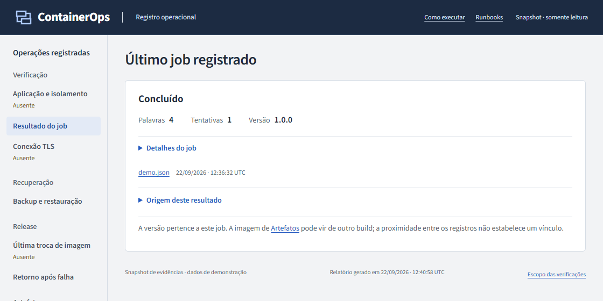

# Problema e solução

O ContainerOps testa a recuperação de jobs aceitos pela API, a restauração do banco e a troca de versão da aplicação. Tudo roda localmente, com dados sintéticos.

## Admissão e processamento

A API recebe texto e uma chave. PostgreSQL guarda o job, e o worker assume uma posse temporária (*lease*) para calcular a contagem de palavras e o SHA-256. O proprietário consulta o resultado pelo UUID.

| Requisição | Resposta |
| --- | --- |
| Chave nova | 201 e um UUID |
| Mesma chave e conteúdo, pelo mesmo proprietário | 200 e o UUID existente |
| Mesma chave com texto ou duração diferentes | 409 |
| Consulta de um job de outro proprietário | 404 |

[`submit_job`](../app/src/containerops/repository.py) aplica essas regras na transação, antes de consumir quota para um novo job. Alice e Bob podem usar `pedido-42` sem compartilhar o trabalho: a chave pertence a cada proprietário.

O [domínio](../app/src/containerops/domain.py) calcula o checksum dos bytes UTF-8 originais. Pela regra de contagem, `Olá, mundo!` tem duas palavras; `d'água guarda-chuva`, quatro. Os testes cobrem o [contrato HTTP](../app/tests/test_http_contract.py), a [contagem](../app/tests/test_domain.py) e a [concorrência e autorização](../app/tests/test_integration.py).

Na [jornada de 22/09/2026](evidence/editorial-20260922/journey.json), seis chamadas simultâneas com a mesma chave retornaram um único job. Alterar o conteúdo retornou 409; consultar por outro proprietário, 404.

## Recuperação do worker

Se o worker morre durante o cálculo, outro processo pode assumir o mesmo UUID depois que a lease expira. A nova tentativa recebe outro token. Para renovar a posse ou concluir o job, são exigidos o token atual e uma lease válida.

O processamento pode repetir. A proteção cobre a gravação do resultado no PostgreSQL; cobranças e envio de mensagens exigiriam controle próprio de idempotência.

| Verificação | Resultado |
| --- | --- |
| [Worker encerrado com SIGKILL](evidence/problem-proof/881fdd3dd92f4b7f86c6862e9022a589/verify-recovery.json) | Mesmo UUID concluído na tentativa 2 |
| [Recuperação de 22/09/2026](evidence/editorial-20260922/recovery.json) | Retomada após SIGKILL, encerramento com SIGTERM e recuperação do banco registrados |
| `test_stale_worker_cannot_renew_or_overwrite_result` | Renovação e conclusão recusadas para um token antigo |

O teste de token antigo roda com PostgreSQL e integra os 116 casos aprovados na [execução de 22/09/2026](evidence/editorial-20260922/execution.json).

PostgreSQL atende à fila deste laboratório. O despacho usa [`SKIP LOCKED`](https://www.postgresql.org/docs/current/sql-select.html#SQL-FOR-UPDATE-SHARE) em transações curtas; a conferência dos dados restaurados usa um snapshot completo.

## Backup e restauração

[`backup`](../scripts/ops.py) pausa novas admissões e drena a fila antes de capturar o snapshot e gerar o dump. `restore_test` verifica o checksum, restaura em um volume novo, compara os dados e envia um job para conferir a aplicação.

Na [execução com oito jobs](verification.md#execução-de-22092026-utc), os oito registros foram restaurados e um novo trabalho foi concluído. O [registro](evidence/problem-proof/881fdd3dd92f4b7f86c6862e9022a589/restore.json) mostra 45,281 segundos, sem contar a limpeza. É uma medição local. O backup permanece no mesmo computador e precisa de uma cópia externa para resistir à perda do host.

O [incidente do GitLab de 31/01/2017](https://about.gitlab.com/blog/postmortem-of-database-outage-of-january-31/) é uma referência para essa escolha: testar a restauração faz parte da rotina de backup.

## Troca de versão e rollback

A versão 2 amplia o schema e grava um job antes de uma falha controlada no teste de funcionamento. O comando `release` volta API e worker à imagem anterior e confere os resultados, incluindo o job criado pela candidata. A versão 1 continua funcionando com o schema 2 porque a migração é expansiva.

O comando `rollback` também troca as imagens e mantém os dados recentes. Uma migração destrutiva precisaria de outro procedimento. A [execução registrada](evidence/problem-proof/881fdd3dd92f4b7f86c6862e9022a589/rollback.json) e o teste `test_release_two_schema_keeps_release_one_compatible` cobrem esse comportamento.

No relatório, consulte Jobs por período, Cópias de backup e Última troca de imagem. Cada operação informa data, projeto e imagem. O [guia](report-guide.md) explica como localizar os arquivos de origem.

## Capturas de 22/09/2026

A sequência `53365744…` usou três jobs, em uma execução separada do caso com oito registros acima. Após a falha da candidata, a imagem voltou à versão 1, o schema permaneceu na versão 2 e os três jobs continuaram consultáveis. O restore foi conferido em outro projeto.

[Resultado do job inicial](evidence/problem-proof/53365744ff7d4897a142f3bf897dbf39/demo.json).

[Captura do rollback](screenshots/editorial-20260922/rollback.png) · [Dados mantidos após voltar à imagem 1](evidence/problem-proof/53365744ff7d4897a142f3bf897dbf39/rollback.json).

[Captura do restore](screenshots/editorial-20260922/restore.png) · [Três jobs restaurados e um novo job concluído](evidence/problem-proof/53365744ff7d4897a142f3bf897dbf39/restore.json) · [Cópia adulterada recusada](evidence/problem-proof/53365744ff7d4897a142f3bf897dbf39/corrupted-copy-rejected.json) · [Origem preservada](evidence/problem-proof/53365744ff7d4897a142f3bf897dbf39/source-preservation.json).

Os [detalhes dessa execução](demo.md#execução-editorial-de-22092026) e a [galeria da interface atual](screenshots.md) estão documentados separadamente.

## Critérios de validação

| Cenário | Critério |
| --- | --- |
| Admissão concorrente | Um UUID por proprietário e chave; 409 para conteúdo divergente |
| Quota | Limites atômicos de 20 pendentes por proprietário e 100 globais; replay continua disponível |
| Distribuição da fila | Com backlog de Alice e Bob, quatro despachos concorrentes distribuem dois jobs para cada um |
| Recuperação | Nova tentativa após expirar a lease; token antigo recusado; SIGTERM termina o job atual sem assumir outro |
| Imagem executada | API e worker usam a imagem solicitada, com os hashes de código esperados |
| Isolamento | UID, capabilities, mounts, rede e permissões do banco conferidos nos containers |
| Restore | Checksum válido, snapshot igual e novo job concluído |
| Rollback | Imagem anterior em execução, schema expansivo e dados recentes mantidos |
| Comando `prove` | Projetos próprios por tentativa, retorno não zero em falhas e limpeza ao concluir |
| Artefatos | Imagem, SBOM, provenance e scan associados aos mesmos digests |

O roteiro espera 3 jobs após a jornada, 5 após a candidata recusada, 6 após a promoção, 7 após o rollback manual e 8 após TLS. O restore deve recuperar os oito e processar um novo. Ao fim, nenhum job pode estar pendente, em execução ou falho. Rejeições não devem adicionar registros.

O [manifesto mais recente](evidence/problem-proof-latest.json) identifica a tentativa e os hashes. A [página de verificação](verification.md) registra os comandos e resultados das suítes de aplicação, operações e relatório, incluindo os cenários com containers.
