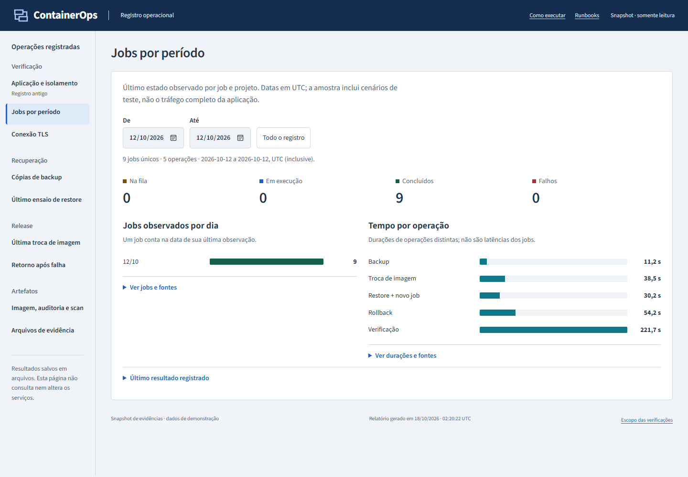
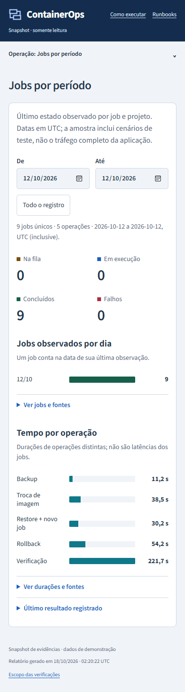
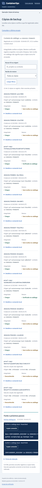

# Capturas do relatório

## Jobs por período

Captura real do [exemplo local](examples/report.html#result) no Edge, a 1440 px.
Os dados são os registros operacionais de 12/10/2026, renderizados com a interface
atual. São nove jobs únicos observados e cinco durações; a captura não executa
novas operações nem consulta a fila atual.

Versão a 390 px, com os mesmos arquivos e intervalo. Gráficos, totais e tabelas
usam a seleção de dias UTC, incluindo início e fim. Os valores exatos e os links
para as fontes ficam nos detalhes de cada gráfico.

## Catálogo de cópias

O catálogo mostra ID, data e origem de cada cópia, com integridade e recibo de
restore separados. Abra o [exemplo do relatório](examples/report.html#backups)
ou consulte o [guia de leitura](report-guide.md).

As capturas abaixo foram atualizadas no mesmo navegador, em 1440 e 390 px.

### Desktop

### Celular

